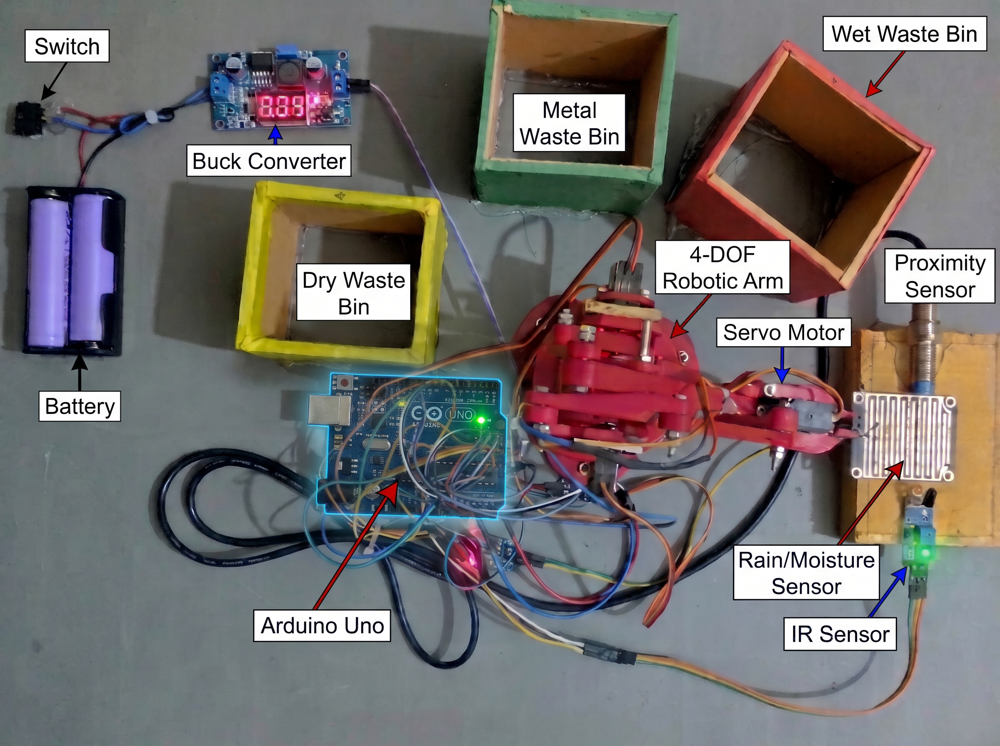
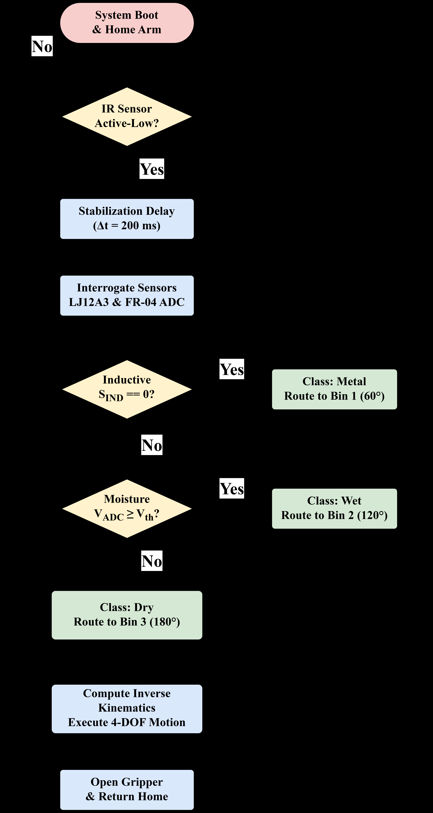
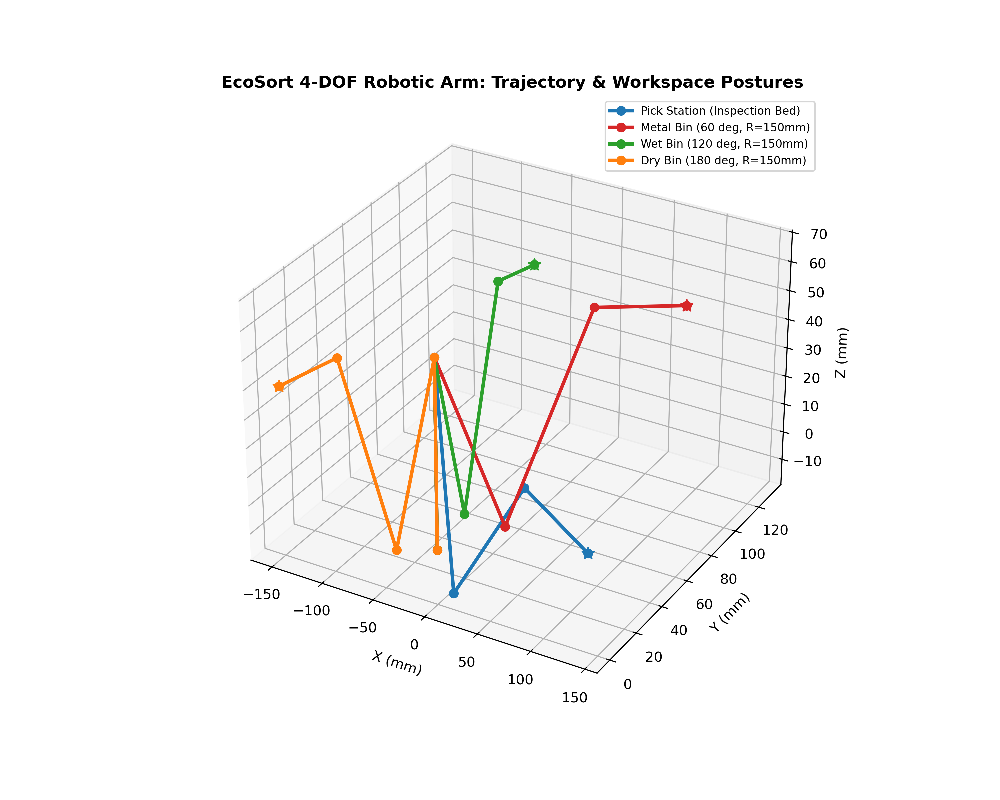
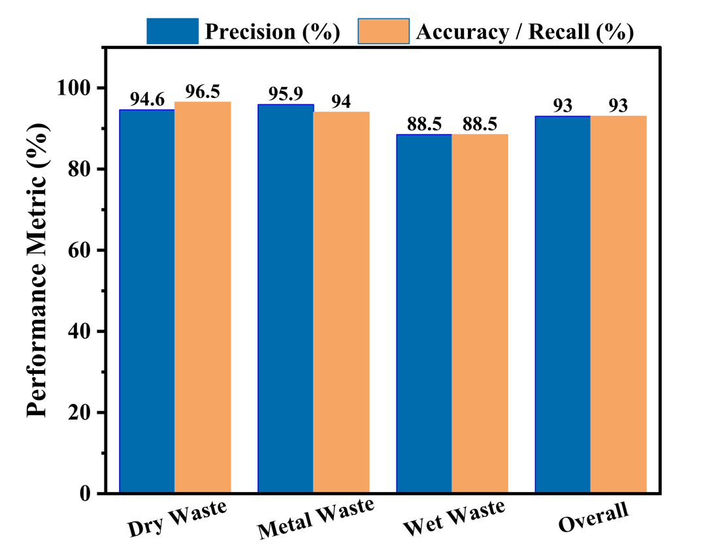
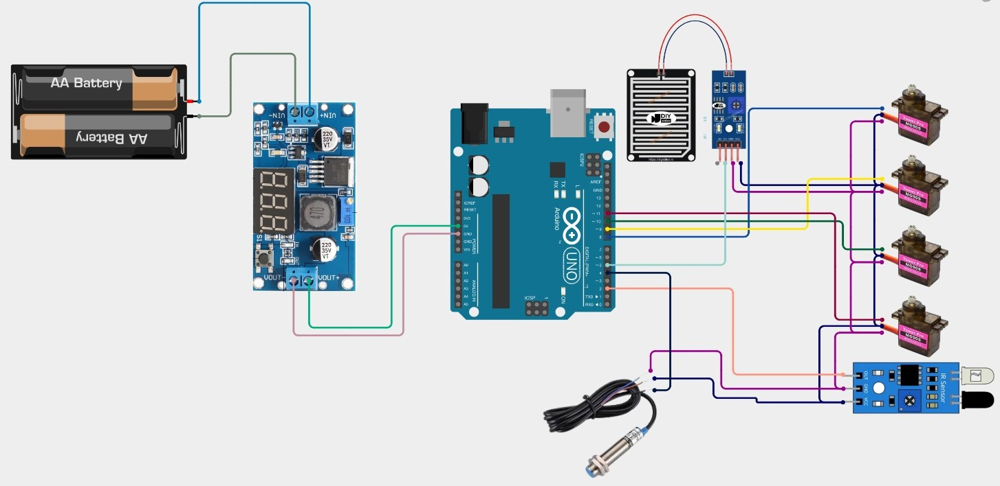

# EcoSort: Autonomous 4-DOF Robotic Manipulator with Priority-Based Multi-Sensor Fusion for Waste Segregation

[](https://www.arduino.cc/)
[](https://isocpp.org/)
[-brightgreen.svg)]()
[]()
[-orange.svg)]()
[](LICENSE)

An ultra-low-cost, autonomous 4-Degree-of-Freedom (4-DOF) robotic manipulator engineered for localized multi-stream municipal solid waste (MSW) segregation. Eliminating expensive computer vision accelerators and optics prone to dust contamination, **EcoSort** integrates an active infrared ingress trigger, an inductive proximity sensor, and an electrolytic moisture array governed by a deterministic, multi-pass temporal priority finite state machine (FSM).

---

## 📸 Physical Prototype & Experimental Setup

<div align="center">
  
  <p><em>Figure 1: Fabricated EcoSort 4-DOF robotic sorting prototype with sensor cluster, 3D-printed links, power regulation bus, and three-bin collection platform.</em></p>
</div>

---

## 🌟 Key Highlights

- **Camera-Free Multi-Sensor Matrix:** Circumvents the $50,000+ capital barrier of optical/NIR sorters by utilizing discrete physical transducers (Active IR, Inductive Proximity, Electrolytic Moisture).
- **Deterministic Priority FSM:** Strict hierarchical classification (**Metal > Wet > Dry**) paired with a 3-pass temporal majority-voting filter ($75\text{ ms}$ interval) to prevent false positives from sensor chatter.
- **Embedded D-H Closed-Form Inverse Kinematics:** Directly embedded on an 8-bit ATmega328P MCU ($1.4\text{ ms}$ compute latency), eliminating the need for tethered PC controllers or offboard compute.
- **Smooth Jerk-Limited Actuation:** $15\text{ ms/deg}$ rate-limited servo trajectory execution preventing dynamic payload swing and slippage.
- **Empirical Validation:** Demonstrated **93.00% overall sorting accuracy** across 300 real-world municipal waste trials at **$3.80\text{ s/item}$** cycle time.
- **Frugal Turnkey BOM:** Entire physical hardware and sensing cluster fabricated at **5,783 BDT ($\approx \$49.34\text{ USD}$)**.

---

## 🔄 System Architecture & Working Principle

<div align="center">
  
  <p><em>Figure 2: System architectural block diagram of the EcoSort platform, illustrating sensor acquisition, MCU decision logic, and actuator drive stages.</em></p>
</div>

The sorting sequence operates as a closed-loop **Sense-Think-Act** routine:

<div align="center">
  
  <p><em>Figure 3: Algorithmic decision flowchart executed by the embedded firmware, detailing sequential material discrimination and 4-DOF trajectory routing.</em></p>
</div>

---

## 📐 Kinematic Modeling (Denavit-Hartenberg)

The manipulator follows an articulated serial revolute topology ($R \perp R \parallel R \parallel R$) modeled using classical Denavit-Hartenberg (D-H) parameters:

### D-H Parameter Specifications
| Link ($i$) | Joint Angle ($\theta_i$) | Link Twist ($\alpha_i$) | Link Length ($a_i$) | Link Offset ($d_i$) |
| :---: | :---: | :---: | :---: | :---: |
| **1** | $\theta_1^*$ (Base) | $+90^\circ$ | $0\text{ mm}$ | $d_1 = 65\text{ mm}$ |
| **2** | $\theta_2^*$ (Shoulder) | $0^\circ$ | $a_2 = 80\text{ mm}$ | $0\text{ mm}$ |
| **3** | $\theta_3^*$ (Elbow) | $0^\circ$ | $a_3 = 80\text{ mm}$ | $0\text{ mm}$ |
| **4** | $\theta_4^*$ (Gripper) | $0^\circ$ | $a_4 = 60\text{ mm}$ | $0\text{ mm}$ |

### Closed-Form Inverse Kinematics
Given target Cartesian coordinate $P = [P_x, P_y, P_z]^T$ and fixed approach pitch $\phi = \theta_2 + \theta_3 + \theta_4$:

$$\theta_1 = \text{atan2}(P_y, P_x)$$

$$r = \sqrt{P_x^2 + P_y^2} - a_4 \cos(\phi), \quad z' = P_z - d_1 - a_4 \sin(\phi)$$

$$\cos\theta_3 = \frac{r^2 + (z')^2 - a_2^2 - a_3^2}{2 a_2 a_3}, \quad \theta_3 = \text{atan2}\left(\sqrt{1 - \cos^2\theta_3}, \cos\theta_3\right)$$

$$\theta_2 = \text{atan2}(z', r) - \text{atan2}\left(a_3 \sin\theta_3, a_2 + a_3 \cos\theta_3\right)$$

$$\theta_4 = \phi - (\theta_2 + \theta_3)$$

<div align="center">
  
  <p><em>Figure 2: 3D kinematic simulation of the 4-DOF manipulator executing trajectories toward inspection bed and all three deposition bins.</em></p>
</div>

---

## 📊 Empirical Experimental Results

Validation was conducted across **300 real-world municipal refuse items** ($N = 100$ per stream):
- **Dry Waste:** Paper cartons, packaging foams, polymer bottles, cardboard shreds.
- **Metal Waste:** Aluminum soda cans, steel bolts, tin caps, copper cable segments.
- **Wet Waste:** Vegetable peels, fruit pulp, cooked rice scraps, wet tea residue.

### Classification & Sorting Accuracy ($N=100$ per class)

<div align="center">
  
  <p><em>Figure 4: Classification accuracy and precision metrics across 300 municipal waste trials.</em></p>
</div>

| Waste Stream | Tested Samples | Correct Segregation | Precision | Recall | Accuracy |
| :--- | :---: | :---: | :---: | :---: | :---: |
| **Dry Recyclable Waste** | 100 | 96.5 | 94.61% | 96.50% | **96.50%** |
| **Metallic Waste** | 100 | 94.0 | 95.92% | 94.00% | **94.00%** |
| **Wet Organic Waste** | 100 | 88.5 | 88.50% | 88.50% | **88.50%** |
| **Overall System** | **300** | **279.0** | **93.01%** | **93.00%** | **93.00%** |

### Latency Profile per Sorting Cycle
| Subsystem Phase | Hardware / Routine | Mean Latency | Standard Deviation |
| :--- | :--- | :---: | :---: |
| Ingress Interruption | Active IR Sensor (LM393) | $14.2\text{ ms}$ | $\pm 1.5\text{ ms}$ |
| Metallic Interrogation | LJ12A3-4-Z/BX ($100\text{ Hz}$ Osc.) | $18.5\text{ ms}$ | $\pm 2.1\text{ ms}$ |
| Moisture Interrogation | FR-04 10-bit ADC Sampling | $24.8\text{ ms}$ | $\pm 3.2\text{ ms}$ |
| Kinematic Computation | Closed-Form Inverse Kinematics | $1.4\text{ ms}$ | $\pm 0.2\text{ ms}$ |
| Gripper Actuation | MG90S Jaw Closure | $220.0\text{ ms}$ | $\pm 12.0\text{ ms}$ |
| Trajectory Transfer Arc | Coordinated 3x MG90S Servos | $1840.0\text{ ms}$ | $\pm 45.0\text{ ms}$ |
| Release & Return Homing | Reset to Home Stance ($0^\circ$) | $1680.0\text{ ms}$ | $\pm 38.0\text{ ms}$ |
| **Total Cycle Duration** | **Full Ingress to Reset** | **$3798.9\text{ ms}$ ($\approx 3.80\text{ s}$)** | **$\pm 65.4\text{ ms}$** |

*Throughput: $\approx 947\text{ items/hour}$. Electronic decision latency accounts for $<1.6\%$ of the total cycle.*

---

## ⚖️ Comparative Benchmark with Recent Literature

| System / Study | Sensing Approach | Actuation Mechanism | Sorting Accuracy | Cycle Latency | Fabrication Cost |
| :--- | :--- | :--- | :---: | :---: | :---: |
| Diya et al. (2018) | Camera / Vision | 4-DOF Robotic Arm | 82.0% | $\approx 5.0\text{ s}$ | $\approx \$80\text{ USD}$ |
| Adediran et al. (2023) | AI / Neural Net | 4-DOF Articulated Arm | 88.0% | $\approx 4.5\text{ s}$ | $\approx \$120\text{ USD}$ |
| Vesga et al. (2025) | Capacitive Sensor | Single-Axis Flap Bin | 91.0% | N/A | $\approx \$35\text{ USD}$ |
| **EcoSort (This Work)** | **Multi-Sensor Fusion** | **4-DOF Articulated Arm** | **93.0%** | **$3.80\text{ s}$** | **$49.34\text{ USD}$** |

---

## 💰 Itemized Bill of Materials (BOM)

| Subsystem Component | Specification / Model | Qty | Cost (BDT) | Cost (USD) |
| :--- | :--- | :---: | :---: | :---: |
| 4-DOF Arm Frame | 3D-Printed High-Density PLA (45% infill) | 1 | 2,800 BDT | $23.89 |
| Microcontroller Unit | Arduino Uno R3 (ATmega328P, 16 MHz) | 1 | 988 BDT | $8.43 |
| Actuator Servos | TowerPro MG90S Metal-Gear Micro-Servos | 4 | 836 BDT | $7.13 |
| DC-DC Buck Converter | LM2596 Step-Down (150 kHz, 2A continuous) | 1 | 245 BDT | $2.09 |
| Rechargeable Battery | IMR 18650 Li-ion Cells (3.7V, 2000 mAh each) | 2 | 296 BDT | $2.53 |
| Ingress Sensor | Active-Low IR Sensor Module (LM393) | 1 | 40 BDT | $0.34 |
| Moisture Sensor | FR-04 Double-Sided Nickel Plate Board | 1 | 83 BDT | $0.71 |
| Inductive Sensor | LJ12A3-4-Z/BX (NPN NO, 4.0 mm sensing range) | 1 | 495 BDT | $4.22 |
| **Total Fabrication Cost** | **Turnkey System** | -- | **5,783 BDT** | **≈ $49.34 USD** |

---

## ⚡ Hardware Pinout & Wiring Connections

<div align="center">
  
  <p><em>Figure 5: Complete electrical schematic and wiring diagram showing LM2596 power regulation, star grounding, and sensor/servo pin connections.</em></p>
</div>

```
      +------------------------------------------------------+
      |                   Arduino Uno R3                     |
      |                                                      |
      |  [Digital Pin 2]  <--- Active-LOW IR Obstacle Out    |
      |  [Digital Pin 4]  <--- LJ12A3-4-Z/BX Inductive Out   |
      |  [Digital Pin 5]  <--- FR-04 Moisture Digital (D0)   |
      |  [Analog Pin A0]  <--- FR-04 Moisture Analog (A0)    |
      |                                                      |
      |  [PWM Pin 8]      ---> Base Servo (J1) Signal        |
      |  [PWM Pin 9]      ---> Shoulder Servo (J2) Signal    |
      |  [PWM Pin 10]     ---> Elbow Servo (J3) Signal       |
      |  [PWM Pin 11]     ---> Gripper Servo (J4) Signal     |
      +------------------------------------------------------+
```
*For complete schematics and star-ground power decoupling details, see [hardware/circuit_schematic.md](hardware/circuit_schematic.md).*

---

## 🚀 Getting Started

### 1. Flashing Firmware to Arduino Uno
1. Open the [Arduino IDE](https://www.arduino.cc/en/software).
2. Open [`firmware/EcoSort_Firmware.ino`](firmware/EcoSort_Firmware.ino).
3. Connect your Arduino Uno board via USB.
4. Select `Tools > Board > Arduino Uno` and choose the corresponding COM port.
5. Click **Upload** (`Ctrl + U`).
6. Open **Serial Monitor** at **9600 baud** to view real-time sensor polling and telemetry.

### 2. Running Kinematic Simulations
To visualize the 3D arm poses and workspace reachability:
```bash
cd kinematics_simulation
pip install -r requirements.txt
python simulation_4dof.py
```

---

## 📂 Repository Structure

```
automated-waste-segregation-robot/
├── firmware/
│   ├── EcoSort_Firmware.ino    # Main Arduino control routine & FSM
│   ├── config.h                 # Pinouts, calibration thresholds & angles
│   ├── kinematics.h             # Inverse/Forward kinematics definitions
│   └── kinematics.cpp           # D-H mathematical solver implementation
├── kinematics_simulation/
│   ├── simulation_4dof.py       # Python 3D workspace and trajectory simulator
│   └── requirements.txt         # Simulation dependencies
├── hardware/
│   ├── circuit_schematic.md     # Wiring schematic and power isolation layout
│   └── bill_of_materials.md     # Detailed itemized BOM with procurement costs
├── docs/
│   └── assets/                  # Prototype photographs and simulation figures
├── .gitignore                   # Clean ignore rules for builds and caches
├── LICENSE                      # MIT Open-Source License
└── README.md                    # Project documentation
```

---

## 👨‍💻 Author

**Md. Al-Imran**  
*B.Sc. in Electronics and Communication Engineering*  
Hajee Mohammad Danesh Science and Technology University (HSTU), Dinajpur, Bangladesh  
- **GitHub:** [@imran7976](https://github.com/imran7976)  
- **Email:** ai.skhimran01@gmail.com
